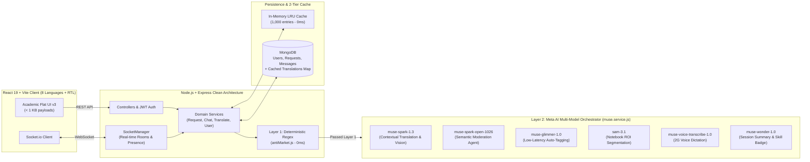

# Éco-Mentorat — Borderless Peer-to-Peer Student Mentoring Network

> **"One question. Any language. The whole world answers."**  
> *« Ici, la langue n'est plus une frontière. »*

**Track:** Meta Global AI Developer Hackathon — *Build for Your World*  
**Author:** NONO YOTCHA Serena Lynn  
**Repository:** [https://github.com/nonoserena/Eco-Mentorat](https://github.com/nonoserena/Eco-Mentorat)

---

## 1. Overview / Présentation Générale

**EN —** **Éco-Mentorat** is a peer-to-peer academic mentoring platform designed with an **Africa-first, low-bandwidth (`< 1 KB/message`, 2G/3G-resilient)** architecture that connects students across borders and languages (e.g., **Douala ↔ Osaka ↔ Rabat ↔ São Paulo**). Powered by an orchestrated pipeline of **6 Meta AI models**, students can photograph a notebook exercise, dictate a question by voice, get matched with a qualified peer mentor, collaborate in real time in **8 languages** (`FR`, `EN`, `JA`, `AR`, `PT`, `ES`, `WO`, `ZH`) with an instant *"See original"* toggle, and earn **verified skill certifications** exported to a recruiter-ready PDF portfolio.

**FR —** **Éco-Mentorat** est une plateforme d'entraide académique pair-à-pair conçue selon une architecture **Afrique-first ultra-légère (`< 1 Ko/message`, compatible 2G/3G)** qui connecte les étudiants sans frontières ni barrières de langue (ex. **Douala ↔ Osaka ↔ Rabat ↔ São Paulo**). Propulsée par **6 modèles d'IA Meta**, elle permet de scanner un cahier d'exercice, dicter une question en vocal, échanger en temps réel dans **8 langues** avec le bouton fixe *« Voir l'original »*, protéger l'éthique académique contre les annonces commerciales ou la triche, et certifier les compétences des mentors sur un portfolio PDF vérifié.

---

## 2. Meta Global AI Developer Hackathon — Baseline vs. New Work

In compliance with the Hackathon rules (*New work only / Startups & existing projects*), here is the exact distinction verifiable via `git log`:

| Phase | Commit & Date | Scope |
|---|---|---|
| **Pre-Hackathon Baseline** | `d707daa` (`2026-10-10`) | Initial MERN scaffold (authentication, basic request board, single-language Socket.io chat, Docker setup). **Zero Meta AI model integration.** |
| **Built During Hackathon** | `7f19666` → `HEAD` (`2026-10-27` – `2026-11-03`) | Complete **6-Model Meta AI Agentic Layer** (`server/src/services/muse.service.js`), real-time cross-language chat & feed translation (`muse-spark-1.3`), autonomous anti-market & anti-cheat moderation (`muse-spark-open-1026`), notebook exercise ROI segmentation & OCR (`sam-3.1` + `Muse Spark Vision`), 2G voice dictation (`muse-voice-transcribe-1.0`), low-latency auto-tagging (`muse-glimmer-1.0`), session summarization & skill certification (`muse-wonder-1.0`), 8-language i18n with RTL support, and Academic Design System v3. |

---

## 3. The 6 Meta AI Models at the Core of Éco-Mentorat

All Meta models are orchestrated in [`server/src/services/muse.service.js`](server/src/services/muse.service.js) and exposed for live verification at `GET /api/meta` ([`server/src/routes/meta.routes.js`](server/src/routes/meta.routes.js)):

| # | Meta AI Model | Role in Éco-Mentorat | Trigger / Endpoint |
|---|---|---|---|
| **1** | **`muse-spark-1.3`** *(Muse Spark series)* | **Real-Time Pedagogical Translation:** Contextual translation across 8 languages (`FR`, `EN`, `JA`, `AR`, `PT`, `ES`, `WO`, `ZH`) preserving code syntax and subject terminology (`skillTag`) in `< 1 KB` payloads. | `POST /api/translate`, WebSocket `send_message`, `GET /api/requests/all` |
| **2** | **`meta-models/muse-spark-open-1026`** *(Muse Spark Open)* | **Autonomous Academic Moderation Agent:** Evaluates both help requests and live chat messages, returning structured JSON `{"label": "OK\|MARKET\|CHEAT", "confidence": 0-1, "reason": "..."}` in the user's language to block commercial spam, paid homework offers, and exam cheating. | `POST /api/requests/create`, WebSocket `send_message` |
| **3** | **`muse-glimmer-1.0`** *(Muse Glimmer Open-Weights)* | **Low-Latency Auto-Tagging & Routing:** Classifies student questions into normalized academic tags (`#python`, `#java`, `#reseau`, `#mathematiques`, etc.) and difficulty levels (`Débutant`, `Intermédiaire`, `Avancé`). | `POST /api/requests/auto-tag` |
| **4** | **`sam-3.1` + `muse-spark-1.3` Vision** | **2-Stage Notebook Exercise Scanner:** `sam-3.1` segments and isolates the exercise bounding box (`roi`) from a photographed notebook page, and `Muse Spark Vision` transcribes the problem statement into a structured request. | `POST /api/requests/scan-exercise` |
| **5** | **`muse-voice-transcribe-1.0`** | **2G Low-Bandwidth Voice Dictation:** Converts spoken student questions into clean, punctuated academic problem statements. | `POST /api/requests/voice-transcribe` |
| **6** | **`muse-wonder-1.0` & `muse-image-1.0`** | **Session Summary & Skill Certification:** Analyzes the mentoring transcript upon closure to generate a 2-sentence pedagogical summary (`aiSummary`) and a certified skill badge (`verifiedSkill`) added to the mentor's PDF portfolio. | `POST /api/requests/complete` |

---

## 4. Key Features Implemented

- **Real-Time Multilingual Request Feed & Chat (`FR`, `EN`, `JA`, `AR`, `PT`, `ES`, `WO`, `ZH`):**
  - Automatic detection of the actual language written by the student (even if their UI is set to another language).
  - Live translation into each viewer's active interface language with MongoDB + in-memory LRU caching.
  - Non-shifting **"See original / See translation"** button on both chat messages and the pinned request header inside the mentoring room.
- **Dual-Layer Academic Protection (Regex + Agentic AI):**
  - Instant zero-latency filter ([`server/src/utils/antiMarket.js`](server/src/utils/antiMarket.js)) combined with `muse-spark-open-1026` semantic moderation blocking product sales, payment offers (*"je te paye 500 tu me traites mes exercices"*), and exam cheating on both request creation and live chat.
- **Anti-Collusion Weighted Reputation & Recruiter PDF Portfolio:**
  - Mathematical reputation score weighting stars, completion ratio (`helpCount / acceptedCount`), and unique learners helped, with a 48-hour anti-collusion window ([`server/src/utils/reputation.js`](server/src/utils/reputation.js)).
  - Downloadable certified PDF portfolio (`GET /api/users/:id/portfolio`).

---

## 5. Architecture & Justification of Technical Choices

To make Éco-Mentorat fast, resilient on African 2G/3G mobile networks, and resistant to abuse, every architectural choice was made deliberately:



### Why These Architectural Choices?

1. **Clean Layered Backend Architecture (`Routes → Controllers → Services → Models` + `SocketManager`):**
   - **Justification:** Separating HTTP transport (`controllers/`) from business logic (`services/`) allows the **exact same translation, moderation, and persistence pipelines** to be shared between REST endpoints (`POST /api/requests/create`, `GET /api/chat/:id/history`) and real-time WebSocket events (`send_message` in [`socketManager.js`](server/src/sockets/socketManager.js)) without code duplication.
2. **Multi-Model Task Specialization Instead of a Single Monolithic LLM:**
   - **Justification:** Using one giant model for every action is too slow and expensive for real-time student mentoring. We route each task to the specialized Meta model best suited for it:
     - **`muse-glimmer-1.0`** handles instant subject classification (`#python`, `#reseau`) on input blur with minimal latency.
     - **`sam-3.1` + `muse-spark-1.3` Vision** split visual segmentation (`roi` extraction) from OCR transcription so noisy backgrounds on student desks do not corrupt the extracted exercise.
     - **`muse-spark-open-1026`** (Open-Weights) handles structured JSON policy enforcement (`OK | MARKET | CHEAT`).
     - **`muse-spark-1.3`** handles subject-aware pedagogical translation (`skillTag` context ensures technical terms like *deadlock*, *pointer*, or *recursion* are never mistranslated).
     - **`muse-wonder-1.0`** runs asynchronously at session closure to synthesize the transcript and certify the mentor's demonstrated skill.
3. **2G/3G Low-Bandwidth Engineering & 2-Tier Translation Caching (`< 1 KB / message`):**
   - **Justification:** In Cameroon and across Francophone Africa, mobile data is costly and connections frequently drop to 2G/3G.
   - Instead of streaming heavy media, chat frames are pure JSON text (`< 1 KB`).
   - Translations use a **two-level cache**: an **in-memory bounded LRU cache** (`1,000` entries in [`translate.service.js`](server/src/services/translate.service.js)) for instant zero-network hits, backed by **persistent MongoDB `Map` fields** (`titleTranslations`, `descriptionTranslations` on `Request`, and `translations` on `Message`). Each message or request is translated **at most once per target language**, saving both mobile bandwidth and Meta API tokens.
4. **Hybrid Dual-Layer Moderation (`0ms Regex` + `3.5s Bounded AI Agent`):**
   - **Justification:** Calling an LLM on obvious spam wastes tokens and adds latency, while relying *only* on regex misses subtle paraphrasing.
   - **Layer 1 ([`antiMarket.js`](server/src/utils/antiMarket.js)):** Deterministic regex with word boundaries (`\b`) blocks explicit phone numbers, Mobile Money (`MOMO`, `OM`), sales keywords (*chaussures*, *habits*), and paid homework offers (*"je te paye 500 tu me traites tous mes exercices"*) in `< 1 ms` at zero API cost.
   - **Layer 2 ([`muse.service.js`](server/src/services/muse.service.js) → `sparkModerate`):** If Layer 1 passes, `muse-spark-open-1026` evaluates semantic intent (bounded by a `3.5s` `Promise.race` timeout in chat so a slow network never freezes the mentoring room).
5. **Behavioral Anti-Free-Riding ("Anti-Njoh") & Anti-Collusion Reputation Engine:**
   - **Justification:** Purely free peer-to-peer platforms fail when users consume help without ever contributing back (*free-riding*, known locally in Cameroon as *"njoh"*), or when two friends rate each other 5 stars repeatedly to farm XP.
   - **Invisible Reciprocity Quota (`requestsLeft: 10`):** The counter is intentionally hidden from the UI so users cannot game the threshold. When depleted, the server returns an encouraging reciprocity prompt (*"Tu as beaucoup sollicité la communauté ! Aide un camarade à son tour pour débloquer de nouveaux tickets"*). Helping one peer immediately restores `+1` ticket, and a weekly cron job ([`ticketReset.job.js`](server/src/jobs/ticketReset.job.js)) resets quotas every Sunday at midnight so true beginners are never permanently locked out.
   - **48-Hour Anti-Collusion Window & Weighted Formula ([`reputation.js`](server/src/utils/reputation.js)):** Repeat sessions between the same learner and mentor within 48 hours receive neutral weight, and the score combines average stars (`70%`) with the completion seriousness ratio `helpCount / acceptedCount` (`30%`) plus a diversity bonus for unique students helped.

---

## 6. Tech Stack & Project Structure

- **Frontend (`client/`):** React 19, Vite, Socket.io-client, `react-i18next` (8 languages + Arabic RTL), custom Academic Flat Design System v3.
- **Backend (`server/`):** Node.js, Express, MongoDB & Mongoose, Socket.io, PDFKit, JWT authentication, Helmet & Rate Limiting.

```text
eco-mentorat/
├── client/                     # React + Vite frontend (port 5173)
│   └── src/
│       ├── components/         # DashboardLayout, LanguageSwitcher, ThemeToggle, Icon...
│       ├── context/            # AuthContext, ThemeContext
│       ├── i18n/               # 8-language translation dictionaries (FR, EN, JA, AR, PT, ES, WO, ZH)
│       ├── pages/              # Landing, auth/, dashboard/, chat/, profile/
│       └── services/api.js     # Axios API client
├── server/                     # Express + Socket.io backend (port 5000)
│   └── src/
│       ├── controllers/        # auth, request, chat, translate, user
│       ├── models/             # User, Request, Message
│       ├── routes/             # REST endpoints + /api/meta jury manifest
│       ├── scripts/            # reset-db.js (clean slate), seed.js, backup.js
│       ├── services/           # muse.service.js, translate.service.js, request.service.js...
│       ├── sockets/            # socketManager.js (real-time translation + moderation)
│       └── utils/              # antiMarket.js, reputation.js, tagNormalizer.js
├── HACKATHON.md                # Hackathon submission documentation & model mapping
└── README.md                   # Project documentation & long-term vision
```

---

## 7. Quickstart — Local Installation & Execution

### Prerequisites
- **Node.js** `>= 18.x`
- **MongoDB** running locally on `mongodb://localhost:27017/eco_mentorat`
- **Meta Model API Key** (`META_API_KEY`)

### 1. Clone & Configure Environment
```bash
git clone https://github.com/nonoserena/Eco-Mentorat.git
cd Eco-Mentorat
cp .env.example .env
```

### 2. Install Dependencies
```bash
cd server && npm install
cd ../client && npm install
```

### 3. Optional — Reset Database to a Clean Slate ("En Blanc")
```bash
npm run db:reset --prefix server
```

### 4. Start Backend & Frontend
Open two terminals at the root of the repository:
```bash
# Terminal 1 — Backend API & WebSocket server (http://localhost:5000)
npm run dev:server

# Terminal 2 — React Vite client (http://localhost:5173)
npm run dev:client
```

---

## 8. Vision & Future Roadmap — From Mentoring Platform to Borderless Educational Social Network

Éco-Mentorat is designed to evolve progressively from a peer-to-peer help board into a **complete, borderless educational social network and academic career ecosystem**. Every upcoming module builds directly on our multi-model AI foundation:

### Phase 1 — Multimodal Cross-Language Communication (Documents, Voice & Calls)
1. **Replica-Layout Cross-Language Document & Exercise Translation (Douala ↔ Osaka):**
   - When a Japanese student sends a PDF or image worksheet written entirely in Japanese to a Cameroonian peer, Éco-Mentorat will store the original file in the database, extract and transcribe its content and layout via **SAM 3.1 + Muse Spark Vision**, and deliver a **translated twin copy (`copie conforme`)** in the recipient's language while preserving the original file for reference.
2. **Natural-Accent Voice Messages in Chat (`Voices Transcrits & Doublés`):**
   - Integration of voice notes inside the mentoring chat where spoken messages are transcribed, translated into the recipient's language, and synthesized with a **natural tone and localized accent** matching the recipient's language, alongside the written transcript.
3. **Real-Time Translated Audio & Video Calls:**
   - Low-bitrate peer-to-peer audio and video mentoring calls between students from different countries and languages, with live speech-to-speech/caption translation.

### Phase 2 — AI Fairness Judge for Mentor Ratings (Anti-Bad-Faith Protection)
4. **Automated Conversation Quality & Fair Rating Auditor:**
   - To protect mentors against bad-faith learners (e.g., a student who receives thorough, step-by-step help from a mentor but unfairly leaves a 1-star rating at session closure), an **AI Arbitration Agent (`Muse Spark`)** will analyze the complete session transcript, verify the pedagogical quality of the help provided, and automatically adjust or assign a **fair, objective rating** to protect the mentor's reputation score.

### Phase 3 — The 100% Educational Social Network
5. **Progressive Convergence of Messaging, Communities & Short Educational Media:**
   - **Communities & Study Groups *(WhatsApp-inspired)*:** Thematic study groups, university/school channels, and peer communities with instant cross-language translation.
   - **Academic Feed & Knowledge Sharing *(Facebook-inspired)*:** Students publish study notes, solved challenges, tutorials, and academic discussions.
   - **Short Educational Video Feed, Podcasts & Lives *(TikTok-inspired)*:** Short-form explanatory videos by student creators, educational podcasts, live revision sessions, interactive quizzes, full courses, and **inter-team / inter-country academic challenges**.

### Phase 4 — Verified Tutoring ("Répétiteurs") & Recruiter Marketplace *(Cameroon & Global)*
6. **Home Tutor Discovery (`Statut Répétiteur`) & Company Talent Hub *(LinkedIn-inspired)*:**
   - **For Students & Families (e.g., in Cameroon):** High-performing mentors can activate a **Verified Tutor (`Répétiteur`) status** backed by their real Éco-Mentorat reputation score and AI-certified skills. Families and younger students can search, filter, and book trusted local or remote tutors, while the platform manages offers and listings.
   - **For Companies & Institutions:** Organizations can publish internships, scholarships, and job offers, and recruit top students directly from their verified mentoring portfolio.

---

## 9. License

Distributed under the **ISC License**. Built with passion for students worldwide.
